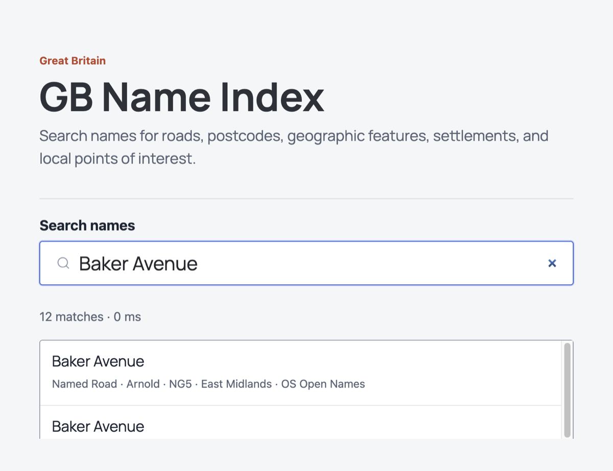

# GB Name Index

GB Name Index combines OS Open Names and Overture Places into one searchable index of names across Great Britain. Use it through a small JavaScript client and a public static index. There is no API key, service fee, backend, or index hosting to set up.

[](https://github.com/Geovation/gb-name-index/actions/workflows/test.yml)
[](https://github.com/Geovation/gb-name-index/actions/workflows/update-places.yml)
[](LICENSE)

[](https://geovation.github.io/gb-name-index/harness/)

## Install a client

Install a versioned client from a GitHub tag:

```bash
npm install @geovation/gb-name-index@github:Geovation/gb-name-index#v0.1.0
```

Replace `v0.1.0` with the release you want. The package is installed from GitHub, not the npm registry. See the [JavaScript client guide](docs/javascript-client.md) for browser and package examples.

## About

The builders select records, normalize names and coordinates, and apply configured category rules. The client searches names by prefix and returns records with source details. Try it in the [search harness](harness/) or read [how the index is built](docs/data-builders.md).

## Core technologies

- **Data:** Python, DuckDB, and pyproj.
- **Client and harness:** JavaScript, Svelte, and Vite.
- **Documentation and hosting:** Jekyll with the Cayman theme on GitHub Pages.
- **Automation:** GitHub Actions tests and publishes the project.

See [Technologies and licenses](docs/technologies-and-licenses.md) for the libraries, what each one does, and its license. Cayman gives the docs a ready-made responsive page layout and base styles; the project only adds its font and diagram styling.

## Develop and contribute

Fork the project to explore or contribute. The [development guide](docs/development.md) covers setup, the harness, tests, and builds.

## Client versions

Versioned client bundles and ZIP downloads are available from [GitHub Releases](https://github.com/Geovation/gb-name-index/releases). See [how releases work](docs/automation-and-releases.md#versioned-client-release).

## Documentation

- [Data builders](docs/data-builders.md): why the sources are combined, build options, and the shared index structure.
- [JavaScript client](docs/javascript-client.md): search options, results, caching, and errors.
- [Search harness](docs/search-harness.md): interface components and local development.
- [Develop and run tests](docs/development.md): local setup, tests, and builds.
- [Tests](docs/testing.md): what the test suites cover.
- [Build and size checks](docs/build-and-size-checks.md): generated files and size limits.
- [Automation and releases](docs/automation-and-releases.md): CI, Pages publishing, and tagged client releases.
- [Technologies and licenses](docs/technologies-and-licenses.md): direct libraries and their terms.

## Attribution and licenses

Project code is MIT licensed. Source data has separate terms, and apps that display records must include attribution. See [Attribution](docs/attribution.md) and [ATTRIBUTION.md](ATTRIBUTION.md).

## Acknowledgments

Thanks to [Ordnance Survey](https://www.ordnancesurvey.co.uk/) for OS Open Names and the [Overture Maps Foundation](https://overturemaps.org/) for Places data. See the [project contributors](https://github.com/Geovation/gb-name-index/graphs/contributors).
