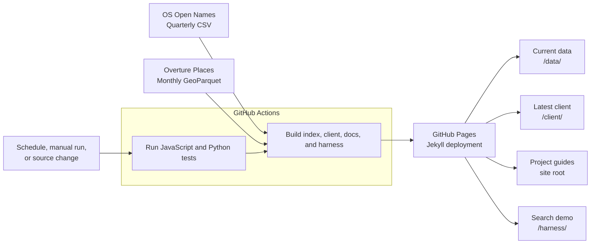

# GB Name Index

GB Name Index makes two complementary open datasets easier to use together. OS Open Names provides Great Britain place names, roads, settlements, and postcodes; Overture Places adds named businesses, landmarks, and points of interest. The project converts selected records into one searchable structure while preserving their sources.

Results use plain JavaScript objects with readable lower-camel-case fields such as `name`, `locality`, `longitude`, and `source`. Each result has one display name rather than exposing source-specific alternate name fields.

Use the tiny JavaScript client and public index directly from your browser app. There is no API key, service fee, backend, or index hosting to set up; your app only needs an internet connection.

[Open the search harness](harness/) to try the index in your browser.

## Install a tagged client

Install from a GitHub release tag using npm:

```bash
npm install @geovation/gb-name-index@github:Geovation/gb-name-index#v0.1.0
```

Then import the client in your application:

```js
import { search } from "@geovation/gb-name-index";

const places = await search("Baker Street");
```

Replace `v0.1.0` with the release tag you want to pin. npm fetches the code from GitHub and builds the client during installation; the package is not published to the npm registry. For a browser app that should not install a dependency, the latest ESM client is also available from GitHub Pages. See the [JavaScript client guide](docs/javascript-client.md).

## About

The builders normalize names, convert coordinates to WGS 84, and map source-specific fields into shared name, type, location, and source fields. They filter categories already covered by the other source, but do not claim to resolve every duplicate place record.

- **Data builders** download the source releases, select records, and write a compact prefix index.
- **JavaScript client** searches those shards by name prefix, with source/category filters and ranking.
- **Search harness** demonstrates search, filtering, and result selection in a browser.
- **GitHub Pages** serves the docs, harness, latest client, and current index; tagged releases provide versioned client bundles.



## Built With

- [Python](https://www.python.org/) — data builders.
- [Requests](https://requests.readthedocs.io/) — source downloads.
- [DuckDB](https://duckdb.org/) — Overture GeoParquet queries.
- [pyproj](https://pyproj4.github.io/pyproj/stable/) — coordinate conversion.
- [Node.js](https://nodejs.org/) — JavaScript build and test runtime.
- [npm](https://www.npmjs.com/) — install development dependencies and run project scripts.
- [Svelte](https://svelte.dev/) — search harness components.
- [Vite](https://vite.dev/) — local server and harness build.
- [Pico CSS](https://picocss.com/) — classless browser-style baseline.
- [Manrope](https://fonts.google.com/specimen/Manrope) via [Fontsource](https://fontsource.org/) — self-hosted open variable font.
- [Lucide](https://lucide.dev/) — source/category ordering icons.
- [esbuild](https://esbuild.github.io/) — ESM, CommonJS, and browser bundles.
- [Jekyll](https://jekyllrb.com/) with [Cayman](https://github.com/pages-themes/cayman) — render project documentation.
- [Mermaid](https://mermaid.js.org/) — diagrams in project documentation.
- [GitHub Actions](https://github.com/features/actions) — tests, data rebuilds, and releases.

## Develop locally

To work on the project or run its search harness, install Node.js 24 and Git:

```bash
git clone https://github.com/Geovation/gb-name-index.git
cd gb-name-index
npm ci
npm run dev
```

Open the local URL printed by Vite. To use another index, set `VITE_NAME_INDEX_BASE_URL` before starting Vite. The sample records are for testing only, not source data.

Run the tests and production build:

```bash
npm test
.venv/bin/python -m unittest discover -s tests -p 'test_*.py'
npm run build
```

To rebuild the full data index locally, run `.venv/bin/python -m builders.build_places_index`. This downloads the current source releases. The scheduled GitHub Actions workflow normally handles that rebuild and publication.

## Client versions

Tagged releases provide versioned ESM, CommonJS, and browser-global bundles through both GitHub-tag npm dependencies and ZIP assets on [GitHub Releases](https://github.com/Geovation/gb-name-index/releases). The latest browser ESM client is also hosted at `https://geovation.github.io/gb-name-index/client/index.js`.

## Documentation

- [Data builders](docs/data-builders.md): why the sources are combined, build options, and the shared index structure.
- [JavaScript client](docs/javascript-client.md): search options, results, caching, and errors.
- [Search harness](docs/search-harness.md): interface components and local development.
- [Tests](docs/testing.md): what is covered and how to run the checks.
- [Build and size checks](docs/build-and-size-checks.md): generated files and size limits.
- [Automation and releases](docs/automation-and-releases.md): CI, Pages publishing, and tagged client releases.

## Attribution

Display the OS Open Names credit with the year for the data edition: **Contains OS data &copy; Crown copyright and database rights Ordnance Survey [year].** OS Open Names is available under the [Open Government Licence v3.0](https://www.nationalarchives.gov.uk/doc/open-government-licence/version/3/).

Credit Overture as **Overture Maps Foundation, overturemaps.org**. Places uses CDLA-Permissive 2.0 or Apache 2.0, depending on source. Check the current [Overture attribution guidance](https://docs.overturemaps.org/attribution/) and [Places licensing details](https://docs.overturemaps.org/guides/places/). The distributable notices are in [ATTRIBUTION.md](ATTRIBUTION.md).

## Contributing

Run the JavaScript and Python tests before opening a pull request. Changes to source, builders, or the client are also tested by GitHub Actions. See [Automation and releases](docs/automation-and-releases.md) for the workflow details.

## Versioning

The package is kept private to the npm registry, but can be installed from a public GitHub tag. Push [Conventional Commits](https://www.conventionalcommits.org/) to `main` to open or update a release PR: `feat:` requests a minor release, `fix:` or `perf:` requests a patch, and a breaking change (`feat!:` or a `BREAKING CHANGE:` footer) requests a major release. Merge the PR to publish the versioned GitHub Release and client archive. Manual `vX.Y.Z` tags are also supported when the tag matches `package.json`.

## Authors

Geovation and the project contributors. See the [contributor history](https://github.com/Geovation/gb-name-index/graphs/contributors).

## License

The project code is licensed under the [MIT License](docs/license.md). The source datasets have separate terms listed above and in [Attribution](docs/attribution.md).

## Acknowledgments

Thanks to [Ordnance Survey](https://www.ordnancesurvey.co.uk/) for OS Open Names and the [Overture Maps Foundation](https://overturemaps.org/) for Places data. The README structure is inspired by [PurpleBooth's README template](https://github.com/PurpleBooth/a-good-readme-template).
