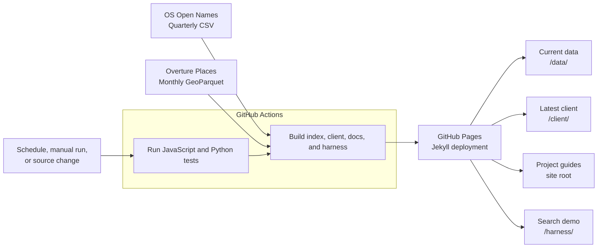

# GB Name Index

GB Name Index combines OS Open Names and Overture Places into one searchable index of names across Great Britain. Records keep their source information and use a shared, readable format.

Use the JavaScript client and public index directly from a browser app. There is no API key, service fee, backend, or index hosting to set up.

[Open the search harness](harness/) to try the index in your browser.

## Install a tagged client

Install a pinned client version from a GitHub release tag using npm:

```bash
npm install @geovation/gb-name-index@github:Geovation/gb-name-index#v0.1.0
```

Replace `v0.1.0` with the release tag you want to use. The [JavaScript client guide](docs/javascript-client.md) shows how to search, filter, and use the browser bundle. The package is installed from GitHub rather than the npm registry.

## About

The builders select records from both sources, normalize names and coordinates, and filter configured category overlaps. They do not resolve every duplicate place. See [Data builders](docs/data-builders.md) for what is included and how the index is built.

The client searches the published index by name prefix, and the [search harness](harness/) lets you try its filters and results in a browser. GitHub Pages hosts the documentation, harness, latest client, and current index.



## Built With

- [Python](https://www.python.org/) — data builders.
- [Requests](https://requests.readthedocs.io/) — source downloads.
- [DuckDB](https://duckdb.org/) — Overture GeoParquet queries.
- [pyproj](https://pyproj4.github.io/pyproj/stable/) — coordinate conversion.
- [Node.js](https://nodejs.org/) — JavaScript build and test runtime.
- [npm](https://www.npmjs.com/) — install development dependencies and run project scripts.
- [Svelte](https://svelte.dev/) — search harness components.
- [Vite](https://vite.dev/) — local server and harness build.
- [Pico CSS](https://picocss.com/) — classless browser-style baseline.
- [Manrope](https://fonts.google.com/specimen/Manrope) via [Fontsource](https://fontsource.org/) — self-hosted open variable font.
- [Lucide](https://lucide.dev/) — source/category ordering icons.
- [esbuild](https://esbuild.github.io/) — ESM, CommonJS, and browser bundles.
- [Jekyll](https://jekyllrb.com/) with [Cayman](https://github.com/pages-themes/cayman) — render project documentation.
- [Mermaid](https://mermaid.js.org/) — diagrams in project documentation.
- [GitHub Actions](https://github.com/features/actions) — tests, data rebuilds, and releases.

## Develop locally

To work on the project or run its search harness, install Node.js 24 and Git:

```bash
git clone https://github.com/Geovation/gb-name-index.git
cd gb-name-index
npm ci
npm run dev
```

Open the local URL printed by Vite. The harness uses sample records unless a local index has been built. See the [Search harness guide](docs/search-harness.md) for details.

Run the tests and build the client and harness:

```bash
npm test
.venv/bin/python -m unittest discover -s tests -p 'test_*.py'
npm run build
```

To rebuild the full index locally, run `.venv/bin/python -m builders.build_places_index`. This downloads the latest source releases. See [Testing](docs/testing.md) for test coverage and [Build and size checks](docs/build-and-size-checks.md) for build outputs.

## Client versions

Tagged releases provide versioned client bundles and ZIP downloads on [GitHub Releases](https://github.com/Geovation/gb-name-index/releases). The [JavaScript client guide](docs/javascript-client.md) covers the release and browser bundle options.

## Documentation

- [Data builders](docs/data-builders.md): why the sources are combined, build options, and the shared index structure.
- [JavaScript client](docs/javascript-client.md): search options, results, caching, and errors.
- [Search harness](docs/search-harness.md): interface components and local development.
- [Tests](docs/testing.md): what is covered and how to run the checks.
- [Build and size checks](docs/build-and-size-checks.md): generated files and size limits.
- [Automation and releases](docs/automation-and-releases.md): CI, Pages publishing, and tagged client releases.

## Attribution

Apps that display index records must include source attribution. See [Attribution](docs/attribution.md) for the required wording and links, and [ATTRIBUTION.md](ATTRIBUTION.md) for distributable notices.

## Contributing

Run the JavaScript and Python tests before opening a pull request. See [Automation and releases](docs/automation-and-releases.md) for CI and publishing details.

## Versioning

Push [Conventional Commits](https://www.conventionalcommits.org/) to `main` to request a release. The [release guide](docs/automation-and-releases.md#versioned-client-release) explains version bumps, release PRs, and manual tags.

## Authors

Geovation and the project contributors. See the [contributor history](https://github.com/Geovation/gb-name-index/graphs/contributors).

## License

The project code is licensed under the [MIT License](docs/license.md). Source data has separate terms; see [Attribution](docs/attribution.md).

## Acknowledgments

Thanks to [Ordnance Survey](https://www.ordnancesurvey.co.uk/) for OS Open Names and the [Overture Maps Foundation](https://overturemaps.org/) for Places data. The README structure is inspired by [PurpleBooth's README template](https://github.com/PurpleBooth/a-good-readme-template).
