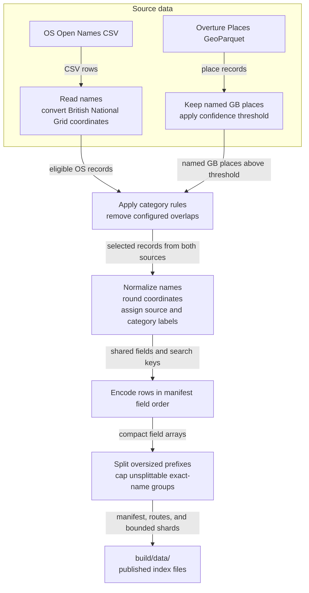

# Data Builders

Apps otherwise have to reconcile two source schemas, coordinate systems, and category systems themselves. The builders do that work once, producing one searchable structure while retaining `source` for attribution and filtering. The main entry point is `builders/build_places_index.py`.

## Build the combined index

From the repository root, run:

```bash
.venv/bin/python -m builders.build_places_index
```

The builder discovers the current OS release and Overture release, reads records for Great Britain, applies the configured confidence and category rules, then writes the output to `build/data/`. The OS archive is cached in `.os-open-names-cache/` and reused until the source release changes. Overture files are read directly from the release assets; a coarse Great Britain bounding box helps prune remote parquet data before the exact country filter is applied.



## The shared index structure

Each source describes places differently. The build maps selected records into common fields so an app can search and filter both without understanding both source schemas. Public field names use lower camel case. A record has one display `name`; source-specific input labels stay inside the builder, not in the returned object. `source` preserves provenance; `category` is the broad filter used to group places, while `subtype` is a more specific source label when available.

| Field | What it contains |
| --- | --- |
| `name` | Display name used for prefix search. |
| `category` | Broad classification used to filter and rank results. |
| `subtype` | More specific source classification, when available. |
| `locality`, `postcodeDistrict`, `region` | Context used to distinguish similarly named results. |
| `longitude`, `latitude` | WGS 84 coordinates rounded to the precision recorded in the manifest. |
| `bbox` | Optional WGS 84 bounds in `[west, south, east, north]` order. |
| `source` | Original dataset name: `OS Open Names` or `Overture Places`. |

`index.json` describes the source releases, field order (`schema`), string lookup tables, filter labels, attribution, and prefix routes. To keep the 5-million-record index small enough for static hosting, shard rows store integers for repeated categories, subtypes, places, regions, postcode districts, and sources. The client expands those indexes back to ordinary strings, so consuming apps never handle numeric dictionary ids.

Records are stored as compact arrays in JSON files named for their normalized name prefix. The client follows `routes` to find a leaf shard. Large prefixes split into longer prefixes to keep files small; exact-name groups that cannot split further are capped and listed in `truncated` so the client can report `moreAvailable`.

For example, the record fields are written in this order:

```text
name, category, subtype, locality, postcodeDistrict,
region, longitude, latitude, bbox, source
```

`bbox` is optional and follows the coordinate order used by [RFC 7946](https://www.rfc-editor.org/rfc/rfc7946#section-5). Overture Places records are points, so their bbox is only the envelope around that point, not the footprint of a park, road, or city. The OS CSV input supplies representative coordinates but no bounds, so OS records have no bbox in this index. For maps, use a meaningful bbox with `fitBounds`; when it is absent or nearly a point, center on `longitude`/`latitude` and choose a useful application zoom instead.

This shared structure is the product's main purpose: one small index and one client instead of separate source integrations. It is not a claim that every duplicate has been reconciled. The overlap policy removes configured categories already represented by OS Open Names; similarly named records may still remain. See [JavaScript client](javascript-client.md) for how apps search the index.

## Build options

Use the source limits for a smaller development build:

```bash
.venv/bin/python -m builders.build_places_index \
  --max-os-records 1000 \
  --max-overture-records 1000 \
  --output build/sample-data
```

Record limits reduce the rows written, but the builder still needs to discover/download its sources. For local Overture input, pass `--overture-input` with a Parquet file, glob, or URL. Other combined-builder options are:

- `--os-download-url` and `--os-cache` select the OS download endpoint and local archive cache.
- `--overture-release` and `--overture-stac-catalog` select the Overture release or catalog.
- `--minimum-confidence` sets the lowest accepted Overture confidence score; the default is `0.8`.
- `--memory-limit` sets DuckDB's memory limit.
- `--include-os-category` / `--exclude-os-category` select OS categories; repeat either flag to name multiple categories.
- `--include-overture-category` / `--exclude-overture-category` do the same for Overture basic categories.
- `--output` chooses the destination directory. The builder replaces this directory when it writes a successful build.

If the same category appears in both an include and an exclude option, the exclusion wins. OS categories must be listed in the builder's category catalog. Overture's category catalog changes between releases, so known categories get display labels while new categories are accepted by default. Categories covered by the overlap policy are excluded unless explicitly included.

The `postcodeDistrict` field adds context; it is separate from the `postcode` filter category, which refers to postcode records.

## Other builder entry points

- `builders/build_os_open_names_index.py` builds an OS-only index. Run it with `python -m builders.build_os_open_names_index`; `--download-url`, `--cache`, `--max-records`, and `--output` control the build.
- `builders/build_overture_places_index.py` builds an Overture-only index. Run it with `python -m builders.build_overture_places_index`; `--input`, `--release`, `--country`, `--bbox`, `--minimum-confidence`, `--max-records`, `--memory-limit`, and `--output` control the build.
- `builders/config.py` contains the output schema, source names, shard limits, category labels/defaults, and Overture overlap policy.

The combined builder is the production path. The source-specific entry points are useful for inspecting or testing one source at a time.