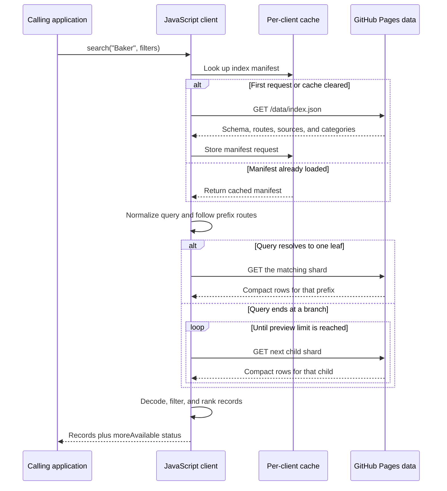

# JavaScript Client

The client gives an app immediate access to the combined OS and Overture data without a search service to build or operate. It fetches the manifest once, finds the relevant shard, and returns matching records. The public lookup has no API key or usage fee, and the consuming app does not need to host the data or run a backend. It does need an internet connection; browser ESM imports also need cross-origin modules allowed by the app's content security policy.

## Install a pinned release

Install a tagged version directly from the public GitHub repository:

```bash
npm install @geovation/gb-name-index@github:Geovation/gb-name-index#v0.1.0
```

Import the client using its package name:

```js
import { search, dataAttribution } from "@geovation/gb-name-index";

const places = await search("Baker Street");
```

Replace `v0.1.0` with the release tag you want to pin. npm clones the tagged source and runs the package's `prepare` build to create the bundles. Git must be available to npm. The package is not published to the npm registry.

## Use the latest client without installing

For browser apps, import the latest ESM bundle from GitHub Pages:

```js
import { search, dataAttribution } from "https://geovation.github.io/gb-name-index/client/index.js";

const places = await search("Baker Street");
```

For a versioned bundle without the GitHub npm dependency, download `gb-name-index-client-vX.Y.Z.zip` from [GitHub Releases](https://github.com/Geovation/gb-name-index/releases). It contains `index.js` (ESM), `index.cjs` (CommonJS), `index.global.js` (browser global), `LICENSE`, and `ATTRIBUTION.md`.

```js
import { createNameIndex } from "./gb-name-index-client/index.js";

const index = createNameIndex({ baseUrl: "https://example.org/gb-name-index/data" });
const places = await index.search("Baker Street");
```

For CommonJS, require the extracted file:

```js
const { search } = require("./gb-name-index-client/index.cjs");
```

For a browser page that uses script tags, load the global bundle and call `NameIndex.search()`:

```html
<script src="https://geovation.github.io/gb-name-index/client/index.global.js"></script>
<script>
  NameIndex.search("Baker Street").then((places) => console.log(places));
</script>
```

The default client uses the public GitHub Pages data directory. `baseUrl` should point to a directory containing `index.json` and its shard files. A custom `fetch` option is useful in tests or runtimes without a global `fetch`.

## Search behavior

`search(query, options)` matches names that start with the query after lowercasing and removing non-alphanumeric characters. Queries shorter than the manifest's minimum length return no results. A search result is an array of decoded records with a `moreAvailable` property.

Records are plain objects with lower-camel-case keys. Each record has one display `name`; source-specific alternate name fields are not repeated in the public API. Optional fields with no value are omitted. The downloaded shard uses integer indexes for repeated strings to stay small; the client resolves those indexes through the manifest and returns normal strings:

```js
{
  name: "Sample Park",
  category: "park",
  locality: "Sampleton",
  region: "Example County",
  longitude: -0.11,
  latitude: 51.49,
  bbox: [-0.11002, 51.48998, -0.10998, 51.49002],
  source: "Overture Places"
}
```

`bbox` is optional and uses `[west, south, east, north]` order. Overture Places records are points, so this is the envelope around the point geometry, not a road, park, or city boundary. OS records in this index have representative coordinates but no bounds. Use `bbox` with a map's fit-to-bounds function only when it is useful; for point-like or missing bounds, center on `longitude` and `latitude` and choose an application zoom.

Options:

- `sources`: only return records from these source names.
- `categories`: only return records in these broad categories.
- `sourcePriority`: order preferred sources in the returned list.
- `categoryPriority`: order preferred categories within a source.
- `previewLimit`: target result count when the query ends at a branch that has several child shards. The default is 20.
- `signal`: cancel in-flight fetches with an `AbortSignal`.

Exact name matches sort first, then source priority, category priority, and stable display fields. Values missing from a priority list sort after listed values. If a filter is omitted, the client does not filter on it.



When a query identifies one leaf shard, the client reads that shard. If the query ends at a routing branch, it visits child shards in a stable order and returns a preview. `moreAvailable` is true when the preview has more child data or the selected leaf is marked as truncated in the manifest.

## Client methods

- `createNameIndex(options)` creates a client with its own cached manifest and shard requests.
- `search(query, options)` returns matching records. A missing shard is treated as an empty result; other failed HTTP responses reject the promise.
- `metadata()` returns the cached manifest. Use it to build source and category filter controls.
- `clearCache()` drops cached manifest and shard data so the next call fetches fresh files.
- `normalize(value)` exposes the same name normalization used for prefix matching.

The module also exports a ready-to-use `nameIndex`, its `search` method, and `dataAttribution`. Display the data attribution in the consuming product; see [Attribution](attribution.md).