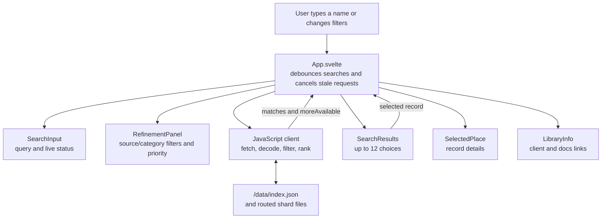

# Search Harness

The harness lets a startup team confirm that the public lookup fits its product before building an integration. It exercises the same combined index and client used by consuming apps, with search, source/category refinements, ranking, and selected-record details. It is also the public demo on GitHub Pages.

The harness demonstrates the public lookup: no API key, service fee, backend, or index hosting is required by a consuming app. Pico CSS provides the baseline styles for semantic controls, typography, and focus states without adding browser JavaScript. Harness-specific layout and result/filter styling lives in one file, `web/src/app.css`; the Svelte components contain no scoped style blocks. Lucide supplies the reorder icons.

## Run it locally

Install the JavaScript development dependencies with `npm ci`, then run:

```bash
npm run dev
```

Vite serves the harness locally with a small synthetic sample index. If `build/data/index.json` exists when Vite starts, it serves that local build instead. Set `VITE_NAME_INDEX_BASE_URL` to use another index. Sample records are only for testing and are not source data. On GitHub Pages, the harness is published at `/harness/` and reads data from `/data/`; the latest client is available from `/client/`.

## What it demonstrates

The manifest supplies the available sources and categories. Results show the context needed to distinguish similar names, and the status indicates when a short list has more matches than shown.

| Component | Purpose |
| --- | --- |
| `web/src/App.svelte` | Owns the client, manifest, current query, filters, selected record, and search status. |
| `web/src/lib/SearchInput.svelte` | Captures the query and announces search status accessibly. |
| `web/src/lib/SearchResults.svelte` | Shows matching places and sends a selected record back to the app. |
| `web/src/lib/RefinementPanel.svelte` | Filters sources and categories, and changes their ranking order. |
| `web/src/lib/SelectedPlace.svelte` | Shows the fields available for the selected record. |
| `web/src/lib/LibraryInfo.svelte` | Shows the current Pages-hosted client import example and documentation links. |
| `web/src/lib/utils.js` | Formats category labels, coordinates, result context, and reorderable lists. |



`npm run build` compiles the harness into `build/harness-preview/harness/`. The build also copies the three client bundles and `ATTRIBUTION.md` into the output's `client/` folder. The Pages workflow publishes the harness at `/harness/` alongside the Jekyll-rendered documentation. See [Build and size checks](build-and-size-checks.md).